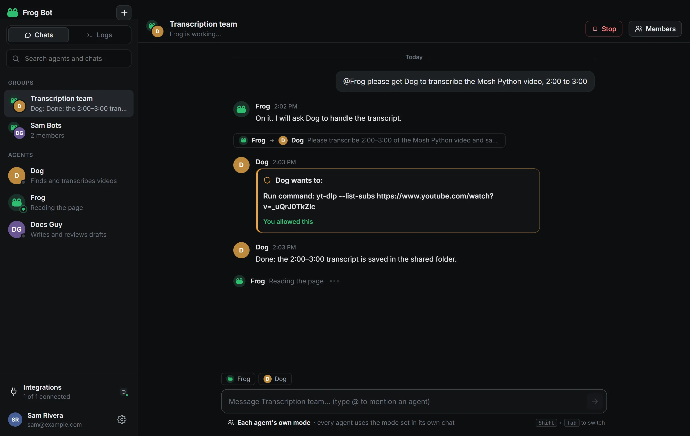

<p align="center"></p>

<h1 align="center">Frog Bot</h1>

<p align="center"><b>Your AI team, on your computer.</b><br>An open-source desktop app for a team of AI agents that work together, use your apps, and ask before they act.</p>

<p align="center">
  <a href="https://sayeemkabir.github.io/frogbot/"><b>Website and downloads</b></a> ·
  <a href="https://sayeemkabir.github.io/frogbot/#videos">Videos</a> ·
  <a href="https://github.com/sayeemkabir/frog-bot/issues">Report an issue</a>
</p>

<p align="center">
  
  
  
</p>

<p align="center"></p>

## What it is

Frog Bot is a desktop chat app (Windows, macOS, Linux). Inside it you have **agents**: teammates with a name, a job, their own memory and their own folder ("computer"). You chat with them like you would with a colleague.

- **They do real work.** Read and write files, run commands, browse the web in their own Chrome, and use connected apps like Slack, Notion and GitHub.
- **They work together.** Agents message each other, hand off tasks, and can ask you to add a new specialist when the team needs one. Put several in a **group chat** and use `@Name` to talk to one.
- **They ask first.** Anything that speaks for you (posting, sending, deleting, changing data in an app) shows an **Allow / Don't allow** card. You can "Always allow" a specific action per agent.
- **They remember.** Each agent keeps a `memory.md`, and the team shares `team-memory.md`. Optional **Learn from my screen** saves screenshots they can look at to learn how you work.
- **They keep going.** Frog Bot sits in the tray while your computer is on, and agents can schedule repeating jobs ("check Slack every 30 minutes").
- **You can see everything.** The **Logs** tab is a live, timestamped, terminal-style feed of every action.

## Getting started (no coding needed)

**Download page: https://sayeemkabir.github.io/frogbot/** (picks the right download for your computer).

| Computer | Install |
|---|---|
| Windows 10/11 | Download and open **FrogBot-Setup-Windows.exe**. If Windows warns you, click **More info → Run anyway**. |
| Mac | In Terminal: `curl -fsSL https://sayeemkabir.github.io/frogbot/install-mac.sh \| bash` |
| Linux (64-bit) | In a terminal: `curl -fsSL https://sayeemkabir.github.io/frogbot/install-linux.sh \| bash` |

Then:
1. Create your account (email and password), then paste an API key: **Claude** (console.anthropic.com, best) or **OpenAI** (platform.openai.com).
2. Say hi to **Frog**. Press **+** to add agents or a group.

That's it. Your key is stored encrypted with your system keychain and never leaves your computer except to talk to the AI provider.

## Everyday use

| You want to… | Do this |
|---|---|
| Give an agent a job | Open its chat and type it in plain words |
| Add a teammate | **+** → New agent (or pick an idea like "Researcher") |
| Work with several agents | **+** → New group, then `@Name` to address one |
| See what an agent is doing | **Details** → **Screen** tab (live steps and browser view) |
| Find files an agent made | **Details** → **Files**, or the shared folder in `FrogsWorld/shared` |
| Connect another app | **Integrations** (bottom left) → pick Slack, Notion, GitHub… or a custom MCP server |
| Choose how free an agent is | The mode under the message box: **Ask first**, **Auto** or **Plan** (or Shift+Tab) |
| Stop an agent | The **Stop** button at the top of the chat |
| Check what happened | **Logs** tab |

Everything Frog Bot keeps lives in one folder: `~/FrogsWorld` (`agents/`, `shared/`, `logs/`, `observations/`, `state/`).

## For developers

Requirements: Node.js 22+, Git.

```bash
git clone https://github.com/sayeemkabir/frog-bot.git
cd frog-bot
npm install
cp .env.example .env      # put ANTHROPIC_API_KEY or OPENAI_API_KEY in .env (or paste it in the app)
npm run dev               # hot-reloading UI, main process rebuilt on save
```

| Command | What it does |
|---|---|
| `npm run dev` | Run the app in development mode |
| `npm start` | Build and run the app |
| `npm test` | Unit and engine tests (no network, no key needed) |
| `FROG_LIVE=1 npx vitest run tests/live.test.ts` | Live tests with a real model (uses your key) |
| `npm run smoke -- --runs 3` | Launches the real app, clicks through every screen, saves screenshots to `smoke-output/` |
| `npm run typecheck` | TypeScript check |
| `node scripts/package-all.mjs` | Build Windows, Mac and Linux installers into `release/` from this one machine |
| `npm run build && node scripts/video/make-setup-videos.mjs <folder>` | Re-make the website videos: films the real app (sign-up, key, chat, teamwork) and narrates it (Windows voice + ffmpeg, no AI) |
| `npm run server` | Headless server mode (see below) |

Installers are published at **github.com/sayeemkabir/frogbot/releases**, and the website lives in that same public repo. `.github/workflows/build.yml` builds on all three systems with GitHub Actions once it is re-enabled.

### How it's built

```
src/
  core/         the engine (no Electron imports, so it also runs on a server)
    engine.ts       agents, chats, turn queue, approvals, scheduler, watch mode
    runner.ts       Claude brain (Claude Agent SDK: the engine behind Claude Code)
    openaiRunner.ts OpenAI brain (same tools, same approval gate)
    frogTools.ts    team tools: message_agent, ask_user, request_new_agent, remember, schedule_task…
    permissions.ts  what runs freely vs. what needs your OK
    integrations.ts MCP apps (browser, Slack, Notion…), oauth.ts signs in and refreshes tokens
  main/         Electron: window, tray, notifications, encrypted keys, IPC, self-test
  renderer/     React UI
  server/       headless HTTP + WebSocket server using the same engine and UI
config/frogbot.config.json   built-in browser integration and app templates
```

The UI only talks to the engine through one typed API (`src/shared/types.ts → FrogApi`), over Electron IPC on the desktop or a WebSocket on a server.

### Server mode (for later hosting)

```bash
FROG_SERVER_TOKEN=<long random string> npm run server
# open http://<server>:4777/?token=<that string>
```

On a server, each agent's browser runs headless in its own Chromium (`npx playwright install chromium` once). OAuth sign-ins (like Slack) are easiest to do once on a desktop first.

### Adding a built-in integration

Add an entry to `config/frogbot.config.json` → `integrations` (auto-connected for everyone) or `templates` (appears under "Add another app" with fill-in fields). Remote MCP servers with OAuth sign-in work out of the box; others can use a token.

## Safety

- Read-only actions run freely. Writing inside an agent's own folder or the shared folder runs freely.
- Commands, changes outside those folders, changes in connected apps, and browser clicks/typing ask first, unless you switch an agent to **Work on its own**.
- Sending, posting and deleting **always** ask, unless you choose "Always allow" for that exact action.
- Agents never sign in, create accounts or solve CAPTCHAs on their own; they ask you.
- Keys and tokens are encrypted with the OS keychain and redacted from logs.

## License

MIT © Sayeem Kabir

## Tutorial

A 2 min 42 s narrated walkthrough for the team lives in `tutorial/frog-bot-tutorial.mp4` (subtitles in `tutorial/frog-bot-tutorial.srt`, script in `tutorial/tutorial-script.md`).
It was made by two Frog Bot agents working together: **Director** briefed **Scriptwriter**, Scriptwriter wrote the narration, and Director built the video with the computer's own voice and ffmpeg. The whole conversation is in `tutorial/collaboration-log.md`. Re-create it with `FROG_LIVE=1 npx vitest run tests/collab.live.test.ts`.
